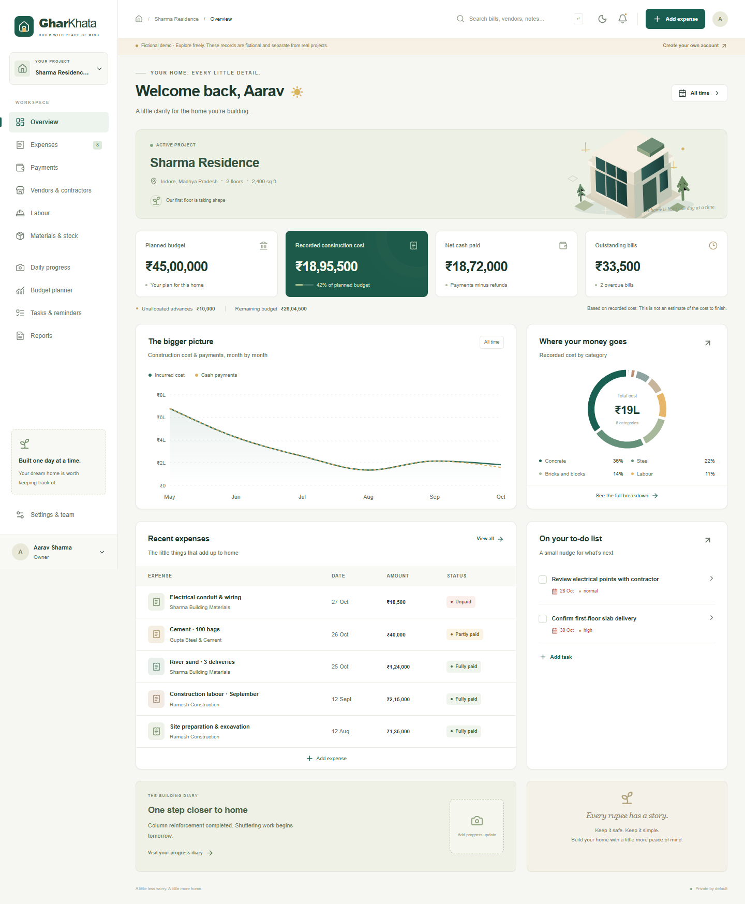

# GharKhata

**Ghar banane ka har kharcha, ek jagah.** A mobile-first construction ledger for Indian homeowners, built with MongoDB/Mongoose, Express 5, React 19, Vite, TypeScript, Tailwind 4, TanStack Query, React Hook Form, Zod, and Recharts.

[Hindi / Hinglish guide](README.hi.md) · [Documentation](docs/README.md) · [Render deployment](docs/DEPLOYMENT.md#render-with-mongodb-atlas) · [API](docs/API.md) · [Verification](docs/VERIFICATION.md)

This is a real API-backed application. No local-storage database, bank connection, payment transfer, invented rates, customer claims, or simulated integrations. The public **Explore the live demo** action creates a separate account and fictional project; demo users cannot create real projects or invite people.



## Project status

The local verification on **31 October 2026** passed the production build, **35 server tests** and **7 browser workflows**, including mobile layouts, financial reconciliation, draft retries, private uploads and worker-switch wage approval. PWA offline-shell and PDF checks also passed. See the [verification report](docs/VERIFICATION.md) for scope and limits.

The repository includes a Render Blueprint, production startup validation and same-origin frontend/API hosting. To go live, supply your own MongoDB Atlas credentials and hosting configuration. The Blueprint uses a **paid Starter service and persistent upload disk**. A public deployment, live email delivery and a fresh dependency advisory audit have not been verified; the latest advisory request timed out.

## Run locally

Requirements: Node **22.12+**, npm, and MongoDB **8+** with transactions enabled (replica set or Atlas). The included local helper uses a separate database directory and port and does not change an existing MongoDB installation.

Clone the repository first:

```sh
git clone https://github.com/amitgond1/GharKhata.git
cd GharKhata
```

From the repository root on Windows:

```powershell
npm.cmd ci
Copy-Item .env.example .env
npm.cmd run db:start
```

Keep MongoDB running. In a second terminal:

```powershell
npm.cmd run dev
```

Open **http://127.0.0.1:5173**. The API runs at **http://127.0.0.1:4000**. Register an account to start with an empty project, or use the isolated demo. Use `127.0.0.1` consistently: the default allowed browser origin is deliberately exact.

On macOS/Linux use `npm` in place of `npm.cmd`. `npm run db:start` looks for `mongod` on PATH on Unix. On Windows it defaults to `C:\Program Files\MongoDB\Server\8.0\bin\mongod.exe`; set `MONGOD_PATH` if yours is elsewhere. The helper starts `rs0` on port `27018`, binds only loopback, and uses `.runtime/mongo`. Stop it with Ctrl+C. **This unauthenticated helper is for local development only.** For Atlas, set `MONGODB_URI` and skip the helper.

`npm run seed` can create additional fictional data. The browser demo action also authenticates you to a newly created copy, so no shared demo password is required.

On macOS/Linux, initial setup is:

```sh
npm ci
cp .env.example .env
npm run db:start
```

Keep that terminal open and run `npm run dev` in another terminal. If `.env` already exists, keep your current settings instead of replacing it with the example.

## Use MongoDB Atlas

1. Create an Atlas database user and allow your development machine's IP in the cluster's Network Access settings.
2. Copy the cluster's **Connect → Drivers → Node.js** connection string into `MONGODB_URI` in the root `.env`. Use the database name `gharkhata`, replace all placeholders and percent-encode special characters in credentials.
3. Run `npm run check:atlas` from the root. This checks the connection without modifying project records or printing credentials.
4. Run `npm run dev`. The local MongoDB helper is not needed when using Atlas.

```dotenv
MONGODB_URI=mongodb+srv://<username>:<password>@<cluster>.mongodb.net/gharkhata?retryWrites=true&w=majority
```

The example is a template. The `gharkhata` database and its collections are initialized when the application connects successfully with the necessary database permissions. A database name visible in Atlas alone does not configure the application connection.

Real `.env` files, private uploads, database files and dependencies are excluded from Git. Commit only the example configuration files; enter production secrets in the hosting dashboard.

## What works

- Public landing page, account registration/login/logout, single-use expiring password reset, profile settings, English/Hindi core UI labels, light/dark themes, and short project onboarding.
- Multiple projects; scoped vendors; multi-item bills with category allocation, quantities, units, rates, discounts, entered tax, delivery charges, receipts, floors/stages, historical opening bills, and atomic immediate payments.
- Partial payments; multiple payments per bill; a payment split across bills; unallocated advances; later advance allocations; credits; refunds; explicit reversals with reasons; financial detail views and chronological vendor ledgers.
- Backend-derived dashboard totals, monthly cost/cash charts, category breakdown, recorded budget use, outstanding liabilities, recent expenses, task reminders, and progress updates. Dashboard defaults to **all time** and supports bill-date, category, vendor, floor, stage and status filters. Filtered cards show whole matching bills and payments allocated to them; project budgets/advances stay explicitly all-time. List and report filters state their basis.
- Vendors and contractor agreements with scope, agreed amount, dates, milestones and approved-change notes. Agreements remain commitments until separately billed.
- Individual workers/teams, full/half/absent or approved overtime day units, attendance snapshots of rates, wage preview/approval, linked labour bills, and protection against duplicate attendance billing.
- Category/stage budgets, threshold indicators, manual remaining-work estimates and explicitly labelled forecasts; recorded cost per user-entered built-up area.
- Stock receipts, usage, wastage, returns, signed adjustments, low-stock alerts, compatible-unit balances and purchase-line linking without duplicate costs.
- Private progress photos/documents, captions, timeline/month filter, gallery, before/after comparison, printable progress diary, tasks with assignees/checklists/attachments, and deduplicated in-app reminders. WhatsApp sharing opens a user-initiated prepared message.
- Project roles, email-bound invitations, pending-invitation revocation, membership revocation, and audit history with before/after data.
- Global project search, filtered and paginated bill/payment screens, a paginated API, CSV reports and browser **Print / save PDF**, plus active-record data export.
- Installable PWA manifest, 192/512 PNG icons and a versioned precached app shell. API responses and attachments are never put in the service-worker cache.
- Clearly labelled expense drafts on the current device, including a persisted request key for safe resubmission after an uncertain response. Drafts are not counted in confirmed totals.

## Financial rules

All stored monetary values are **integer paise**. Form inputs are decimal rupee strings, parsed with `BigInt`; quantities have up to three decimal places. Line multiplication rounds half up to a paise. Discounts and taxes are entered as amounts rather than silently inferred percentages. Wage calculations use explicitly approved decimal day units and integer half-up rounding. Credit allocation across invoice categories uses deterministic largest remainders so categories reconcile and never become negative because of rounding.

```text
Recorded cost      = bills − credit notes
Net cash paid      = payments − refunds
Outstanding        = bills − credits − allocated payments
Available advances = payments − allocations − refunds

Recorded cost − net cash paid = outstanding − available advances
```

A ₹40,000 bill with ₹15,000 and ₹10,000 payments has cost ₹40,000, cash paid ₹25,000, and outstanding ₹15,000. A payment never reduces recorded construction cost. An advance affects cash, not cost. Allocating it affects liabilities/available advances without another cash movement.

Financial writes use MongoDB transactions, a per-project revision lock, and persistent project-scoped idempotency keys with payload fingerprints. Transaction retries use fresh copies of validated data. Membership and role checks run **inside** the write transaction. Concurrent overallocations cannot both commit. The system checks that references and attachments belong to the project.

Financial records are immutable. Correct a mistake by reversing dependent allocations/credits/refunds, voiding the incorrect bill/payment with a reason, then entering the corrected record. Voids retain history and the audit trail. For a paid return, first reverse the relevant allocation, record the credit against the now-open bill, then record a refund from the available payment. A credit cannot exceed current outstanding; a refund cannot exceed available cash. Attendance already included in a wage statement cannot be billed again. Wage statements are permanent approvals; correct them with explicit compensating labour bills/credits. Stock is corrected with signed adjustment movements rather than erasing history.

Amounts are bounded at the schema level and unsafe aggregate totals are rejected. Project completion does not settle liabilities. Remaining budget is **not** a cost-to-finish estimate. Contract value and unapproved attendance are excluded from incurred cost.

## Data and code structure

```text
client/                  React/Vite TypeScript application
  src/locales/           English and Hindi translation files
  public/                PWA manifest, icons, service-worker template
server/
  src/models.ts          Mongoose entities and indexes
  src/service.ts         Authorization, transactional financial writes
  src/finance.ts         Derived financial summaries
  src/auth.ts            Sessions, CSRF, authentication/reset email
  src/storage.ts         Local/private S3 adapter and upload validation
  src/app.ts             Express API and CSV exports
  src/demo.ts            Isolated fictional demo seed
  test/                  Financial and API integration tests
shared/src/              Zod schemas, types and exact calculations
e2e/                     Playwright browser workflows
scripts/                 Local replica set and PWA packaging helpers
docs/                    API, deployment, verification and screenshots
```

The entities are `User`, `Project`, `Membership`, `Vendor`, `Session`, `Token`, `Attachment`, `Audit`, `Idempotency`, and project-scoped typed `Record` documents. Record kinds are bill, payment, allocation, credit, refund, worker, attendance, wage, budget, contract, stock, log and task. Each kind has its own shared server-enforced Zod schema. Bills/payments have independent records; balances are derived, never maintained in editable redundant fields. Domain records share a collection to keep project-scoped retrieval and audit behavior consistent.

`createdAt`/`updatedAt` are UTC events. Business dates stay `YYYY-MM-DD`; date-only values are not converted through UTC midnight. The supported project display timezone is Asia/Kolkata. Area units are explicitly sq ft or sq m; stock units never auto-convert. Historical bills are labelled on details and in data exports.

## Environment

For deployment on Render with MongoDB Atlas, use the included [Render Blueprint](render.yaml) and follow the [Render setup guide](docs/DEPLOYMENT.md#render-with-mongodb-atlas). The production server serves both the built frontend and API through one HTTPS origin. The Blueprint uses a paid service with persistent upload storage; hosting accounts and real Atlas credentials are required.

Copy [`.env.example`](.env.example) to a **root** `.env`. The backend explicitly loads that file even when run through the server workspace. Existing process variables take precedence. No private configuration is read by the frontend.

| Variable                                      | Purpose                                                                               |
| --------------------------------------------- | ------------------------------------------------------------------------------------- |
| `MONGODB_URI`                                 | Replica-set/Atlas connection string; keep credentials server-side                     |
| `PORT` / `HOST`                               | API listener; defaults 4000 and loopback in development, all interfaces in production |
| `APP_ORIGIN`                                  | Exact allowed origin; Render defaults to RENDER_EXTERNAL_URL                          |
| `NODE_ENV`                                    | `production` enables secure `__Host-` cookies and disables email previews             |
| `UPLOAD_DIR`                                  | Local private storage path relative to the repository root, default `uploads`         |
| `SMTP_URL` / `EMAIL_FROM`                     | Optional real reset/invitation email transport and sender                             |
| `S3_BUCKET` / `S3_REGION`                     | Optional private object storage; setting bucket selects S3                            |
| `S3_ENDPOINT` / `S3_FORCE_PATH_STYLE`         | S3-compatible service configuration                                                   |
| `AWS_ACCESS_KEY_ID` / `AWS_SECRET_ACCESS_KEY` | Backend-only credentials, or use an IAM workload role                                 |
| `TRUST_PROXY`                                 | Explicit trusted proxy hop count; set only to match deployment                        |

Without SMTP, development reset/invitation requests show a **development email preview** with the real single-use link. No email is claimed to be sent. Production returns a configuration error when email is required but unavailable. S3 uses private objects and authenticated API downloads; there is no public bucket URL in the client.

## Validation

Start the local replica set first:

```powershell
npm.cmd test
npm.cmd run build
npm.cmd run test:e2e
```

The API tests create a random `gharkhata_test_*` database, enforce that prefix before cleanup, and never drop the development database. Playwright expects the API and Vite server to be running. On a new machine, install its browser once with `npx playwright install chromium`. To use an existing compatible browser, set `PLAYWRIGHT_CHROMIUM_EXECUTABLE` to the full Chrome/Chromium executable path. In this workspace an existing Chromium was used; no new browser installation was needed.

See [verification results](docs/VERIFICATION.md), [phone layout and device checks](docs/MOBILE.md), and [API documentation](docs/API.md). [Deployment and backup/restore](docs/DEPLOYMENT.md) cover production setup.

## Deliberate limits and optional integrations

- **No AI receipt extraction, voice transcription, LLM financial Q&A, automated WhatsApp delivery, bank transfer integration or automatic purchase-rate comparison.** These optional integrations are not displayed as functioning features.
- Drafts are device-local, manually submitted, and never automatically reconciled in the background. A cold offline reload can show the cached application shell but cannot fetch private project data. Reconnect to resume a saved draft. No full offline database or automatic conflict-resolution queue is claimed.
- Browser print provides actual printable reports and PDF saving; there is no unattended server-side PDF renderer or scheduled report email.
- English/Hindi translation files cover navigation, core forms, financial labels and common actions. Some long explanatory/help text remains English. Additional locales and configurable timezones are not implemented.
- The dashboard snapshot derives totals from project records in a consistent read transaction. The paginated records API is available, while the current UI loads the full snapshot for local chart/list interactions. Very large ledgers will need aggregate read models/streamed reporting.
- Attendance supports full/half/absent presets and custom approved day units with up to three decimals; it does not implement hourly payroll, tax calculations or statutory payroll processing.
- Actual SMTP delivery and S3 persistence require user-provided services and were not exercised against external accounts. Local storage/email previews are tested. Upload processing validates JPEG/PNG/PDF signatures and strips image metadata; malware scanning is not integrated.
- Demo copies persist in the development database. Use a separate demo database/instance and a retention job for an internet-facing demo; the current demo creation endpoint is rate limited.

No production service has been deployed or external email sent by this build.
